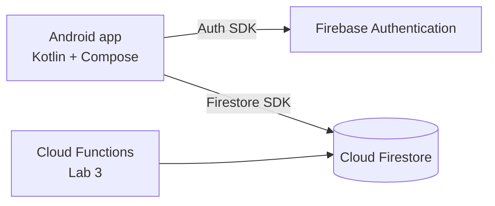

# StudyRoom

> Students waste time looking for a free study room because there is no real-time overview of availability.

StudyRoom is an Android app (Kotlin + Jetpack Compose) backed by Firebase that lets university students see which study rooms are free and book one in a few taps.

## Team

| Member | Roles |
|---|---|
| <Your Name> (@your-github) | Product Owner · Tech Lead · Developer · QA/DevOps |

One-person team – all roles are held by one member.

## MVP features

| # | Feature | Sprint |
|---|---|---|
| 1 | Register, log in, log out, auto-login (Firebase Auth) | **Sprint 1** |
| 2 | Browse a list of study rooms (building, capacity, projector) | **Sprint 1** |
| 3 | Room detail screen with today's reservations | **Sprint 1** |
| 4 | Book a room for a time slot / cancel my reservation | **Sprint 1** |
| 5 | "My reservations" list | Later |
| 6 | Server-side conflict check + reminder notification before a booking (Cloud Functions) | Later (Lab 3) |

Screens (max 5): Login · Register · Room list (Home) · Room detail / booking · My reservations.

## Data model (Cloud Firestore)

| Collection | Fields (type) |
|---|---|
| `users` | `uid` (doc id) · `email` (string) · `displayName` (string) · `createdAt` (timestamp) |
| `rooms` | `name` (string) · `building` (string) · `capacity` (number) · `hasProjector` (boolean) |
| `reservations` | `ownerId` (string → users.uid) · `roomId` (string → rooms id) · `roomName` (string) · `start` (timestamp) · `end` (timestamp) · `status` (string: `active`/`cancelled`) · `createdAt` (timestamp) |

`ownerId` links a reservation to its owner; Security Rules (Lab 2) will allow users to edit only their own reservations.

## Architecture

Inside the app the code is split into three layers:

| Layer | Package | Classes |
|---|---|---|
| Data | `data` | `AuthRepository`, `FirebaseAuthRepository` |
| Logic | `domain`, `ui/auth` | `AuthValidator`, `AuthViewModel` |
| UI | `ui/auth`, `ui/home`, `ui/navigation` | `LoginScreen`, `RegisterScreen`, `HomeScreen`, `AppNavHost` |

## How to run

1. Install the latest stable Android Studio and an emulator image **with Google Play**.
2. Clone: `git clone https://github.com/<owner>/studyroom-app.git` and open it in Android Studio.
3. `app/google-services.json` is committed, so the project builds as is. (To use your own Firebase project, register an Android app with package `com.teamsolo.studyroom` and replace the file.)
4. Wait for Gradle sync, then **Run ▶** on the emulator.
5. Register a new account – you will land on the Home screen.

## Workflow

- `main` is protected: changes go through pull requests (`feature/<name>` branches).
- Issues use the user-story template; the board is **StudyRoom – Sprint board** (Backlog → Sprint 1 → In progress → In review → Done).
